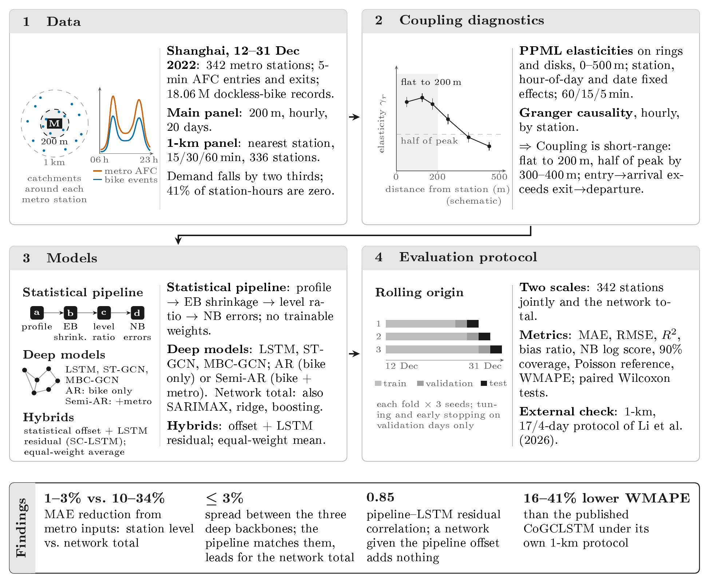

# metro-bike-forecast

Do deep spatiotemporal models improve on a calibrated statistical baseline for
forecasting shared-bike demand around metro stations?



## Project Overview

The code includes:

- **Panel construction** : dockless-bike lock/unlock events are matched to metro
stations and merged with 5-minute AFC entries and exits (main 200 m panel,
distance-ring panel, 1-km nearest-station panel).

- **Coupling diagnostics** : station-level Granger causality tests and PPML
elasticities of bike flow with respect to metro flow by distance band.

- **Statistical pipeline** : intraday profile, empirical-Bayes shrinkage,
recent-level ratio and negative-binomial errors.

- **Deep models** : LSTM, ST-GCN and MBC-GCN with bike-only (AR) and
bike-plus-metro (Semi-AR) inputs, at station level and for the network total,
under a rolling-origin protocol (3 folds × 3 seeds).

- **Hybrids and external check** : an LSTM with the statistical forecast as an
offset, forecast combinations, and a comparison under the 1-km protocol of
Li et al. (2026).

## Datasets

This study draws on Shanghai metro AFC records and dockless shared-bike
lock/unlock logs from 12 December 2022 to 1 January 2023. Both sources were
provided by our partner companies and cannot be released publicly; requests
should be directed to the corresponding author.

To run the code, place your own copies under `data/` with the following
structure and column names.

| File | Required columns |
| --- | --- |
| `bike20221212-20230101.csv` | `BICYCLE_ID`, `DATA_TIME`, `LONGITUDE`, `LATITUDE`, `LOCK_STATUS` |
| `metro_station_coordinates.csv` | `stationnames`, `lon`, `lat` |
| `station_info.csv` | `FSTR_LINEID`, `FSTR_STATIONID`, `FSTR_STATIONNAME` |
| `afc_5min/HIST_STO_5MFLOW_5M_YYYYMMDD.CSV` | `FSTR_LINEID`, `FSTR_STATIONID`, `FDT_STARTTIME`, `FDT_ENDTIME`, `FINT_IN`, `FINT_OUT` |

## Installation

```bash
python -m venv .venv && source .venv/bin/activate
pip install -r requirements.txt
```

## Usage

All code is in one notebook, `src/metro_bike_pipeline.ipynb`. Run Section 0
first, then the sections in order; results are written to `outputs/`.

```bash
jupyter notebook src/metro_bike_pipeline.ipynb
```

| Section | Content | Paper |
| --- | --- | --- |
| 1–2 | Station–time panels | – |
| 3 | Granger causality tests | Table 1 |
| 4–5 | Distance-ring panel, PPML elasticities | Table 2 |
| 6–7 | LSTM, ST-GCN, MBC-GCN at station level | Tables 5, 7, B.2 |
| 8 | Statistical pipeline, SC-LSTM hybrid, combination | Tables 6, 9; Fig. 10 |
| 9 | Network-total forecasts | Tables 7, 8 |
| 10–11 | 1-km panel and comparison with Li et al. (2026) | Table 10 |
| 12 | Figures | Figs. 7, 8, 9, 11 |

## Notes

- Each section reads its inputs from disk, so a section can be rerun on its own
once the earlier sections have written their outputs. Sections 7–9 need the
cell of Section 6 and cache finished training runs.

- The deep models run on CPU, CUDA or Apple MPS; their scores vary slightly
between runs and devices.

